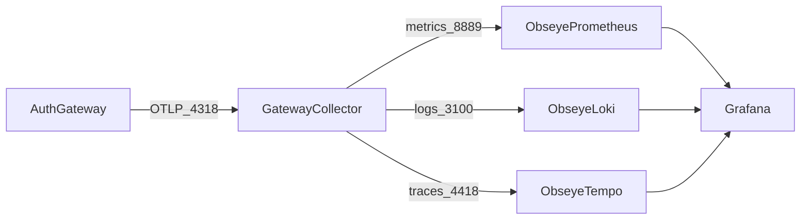

# Align obseye with the auth gateway

This is the obseye baseline. After it is approved, save it in this repo at [.cursor/plans/obseye-gateway-alignment.plan.md](.cursor/plans/obseye-gateway-alignment.plan.md). Do not change the auth gateway, and do not edit `/Users/vriesjo/Development/Home/obseye` from this repo. Carry the file into the obseye project and implement it there.

Scope is the local Docker Compose stack in [obseye/docker-compose.yml](/Users/vriesjo/Development/Home/obseye/docker-compose.yml). [obseye/deployment.yaml](/Users/vriesjo/Development/Home/obseye/deployment.yaml) and the Helm chart are a different deployment and stay out of this baseline.

## Gateway contract, already running

The gateway collector in [service/otel-collector-config.yaml](service/otel-collector-config.yaml) already exports:

- Metrics on host port `8889` (`gateway_operation_duration`, `gateway_operation_count`, service name `itzitzo-auth-gateway`).
- Logs to `http://host.docker.internal:3100/otlp`, which the exporter completes as `/otlp/v1/logs`.
- Traces to `http://host.docker.internal:4418`, which the exporter completes as `/v1/traces`.

The two Compose projects stay on separate networks (`appnet` and `monitoring`). They meet only through published host ports. The gateway process is `run-service.sh` on the host, so Promtail never sees its stdout. Gateway logs arrive through the collector’s Loki export. Promtail keeps shipping container stdout, including `itzitzo_postgres`, `itzitzo_redis`, and `itzitzo_otel_collector`. No Promtail change.



## Current obseye behavior

- Prometheus is published on host `9090`. Grafana queries it at `http://prometheus:9090` inside the `monitoring` network. [obseye/prometheus/prometheus.yml](/Users/vriesjo/Development/Home/obseye/prometheus/prometheus.yml) does not scrape the gateway. It already uses `host.docker.internal` for `proaktive-db`.
- cAdvisor is published on host `8080`. Prometheus scrapes `cadvisor:8080` on the Docker network, so the host publish is unused by Grafana.
- Loki is published on host `3100`. [obseye/loki/loki-config.yml](/Users/vriesjo/Development/Home/obseye/loki/loki-config.yml) does not set `allow_structured_metadata`. The collector currently retries that port with `connection refused` when Loki is down.
- [obseye/grafana/provisioning/datasources/datasources.yml](/Users/vriesjo/Development/Home/obseye/grafana/provisioning/datasources/datasources.yml) has Prometheus and Loki. Dashboards refer to those datasources by name. There is no Tempo.
- Host `8080` is the gateway. Host `9090` is the gateway MCP client. Host `4317` and `4318` belong to the gateway collector.

## Target behavior

- cAdvisor has no host port. Prometheus still scrapes `cadvisor:8080` on `monitoring`.
- Prometheus is published as `9095:9090`. The in-container listen port and the Grafana URL stay `9090`.
- Prometheus scrapes `host.docker.internal:8889` and resolves that name through `extra_hosts: ["host.docker.internal:host-gateway"]`.
- Loki accepts OTLP on the existing port `3100` by setting `allow_structured_metadata: true` under `limits_config`. The image must be Loki 3 or newer, which `grafana/loki:latest` is.
- A new Tempo service stores traces locally. Grafana gets a Tempo datasource at `http://tempo:3200`.
- Tempo publishes `3200:3200` for queries and `4418:4318` for OTLP HTTP. It does not publish `4317` or `4318`.

## Steps in the obseye repo

1. In [obseye/docker-compose.yml](/Users/vriesjo/Development/Home/obseye/docker-compose.yml), delete the cAdvisor `ports` block. Change Prometheus to `9095:9090` and add the `host.docker.internal` extra host. Leave the Prometheus healthcheck on `localhost:9090`.
2. Add this scrape job to [obseye/prometheus/prometheus.yml](/Users/vriesjo/Development/Home/obseye/prometheus/prometheus.yml):

```yaml
- job_name: 'itzitzo-auth-gateway'
  static_configs:
    - targets: ['host.docker.internal:8889']
      labels:
        instance: 'itzitzo-auth-gateway'
```

3. Add `allow_structured_metadata: true` under `limits_config` in [obseye/loki/loki-config.yml](/Users/vriesjo/Development/Home/obseye/loki/loki-config.yml). Leave the listen port at `3100`.
4. Add `tempo/tempo.yaml` and a `tempo` service. Named volume `tempo-data` mounted at `/var/tempo`. Image `grafana/tempo:latest`. Command `-config.file=/etc/tempo.yaml`.

```yaml
server:
  http_listen_port: 3200

distributor:
  receivers:
    otlp:
      protocols:
        http:
          endpoint: 0.0.0.0:4318

ingester:
  trace_idle_period: 10s
  max_block_duration: 5m

compactor:
  compaction:
    block_retention: 48h

storage:
  trace:
    backend: local
    wal:
      path: /var/tempo/wal
    local:
      path: /var/tempo/blocks
```

5. Add a Tempo datasource to [obseye/grafana/provisioning/datasources/datasources.yml](/Users/vriesjo/Development/Home/obseye/grafana/provisioning/datasources/datasources.yml). Give Prometheus, Loki, and Tempo stable `uid` values `prometheus`, `loki`, and `tempo`. Existing dashboards use the names `Prometheus` and `Loki`, so the names stay. Point Tempo trace-to-logs at uid `loki` and trace-to-metrics at uid `prometheus`. URL `http://tempo:3200`.
6. Update the Docker Compose access lines in [obseye/README.md](/Users/vriesjo/Development/Home/obseye/README.md): Prometheus UI at `http://localhost:9095`, no cAdvisor host URL, Tempo query at `http://localhost:3200`. Leave the Kubernetes port-forward section unchanged.

`ServiceDown` in [obseye/prometheus/alerts.yml](/Users/vriesjo/Development/Home/obseye/prometheus/alerts.yml) already alerts when a scraped job is down. Once the gateway job exists, a stopped gateway collector raises that alert. Leave the rule as it is.

## Verification

- Host ports `8080` and `9090` are free for the gateway and the MCP client. obseye binds `3000`, `3100`, `3200`, `4418`, `9093`, `9095`, and `9100`.
- `http://localhost:9095/targets` shows `itzitzo-auth-gateway` up while the gateway collector is on `8889`.
- With both stacks up, a `POST /gateway/login` shows `gateway_operation_duration` in Grafana, a Loki line for service name `itzitzo-auth-gateway`, and a Tempo trace whose root span is `UserController.login`.
- Stopping Loki or Tempo does not stop the gateway. The gateway collector retries and still writes `service/telemetry/my-telemetry-output.json`.

## Risks

- `grafana/loki:latest` and `grafana/tempo:latest` are unpinned. OTLP ingestion needs Loki 3 or newer.
- Changing datasource uids can duplicate a datasource that Grafana already stored in the `grafana-data` volume. If Explore shows two Prometheus datasources, remove the old generated one.
- On this Mac, `host.docker.internal` is the Docker Desktop VM, which is the same path the existing `proaktive-db` scrape uses.
